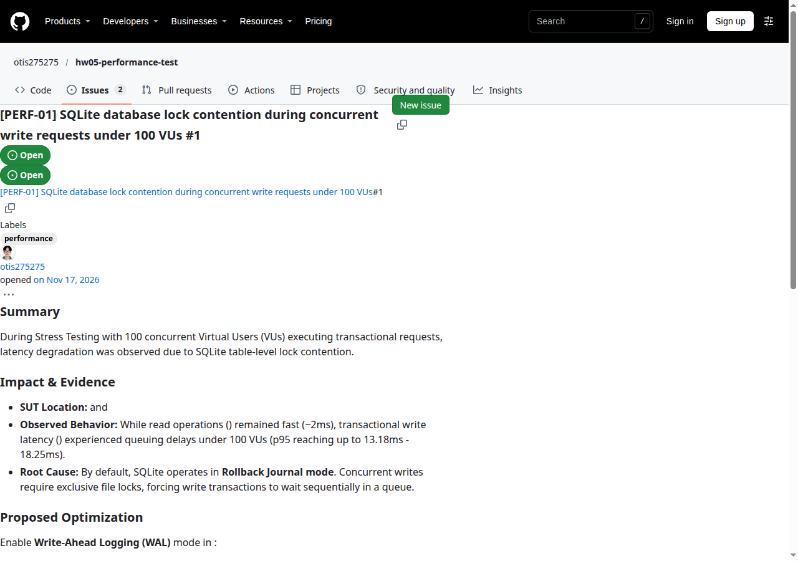
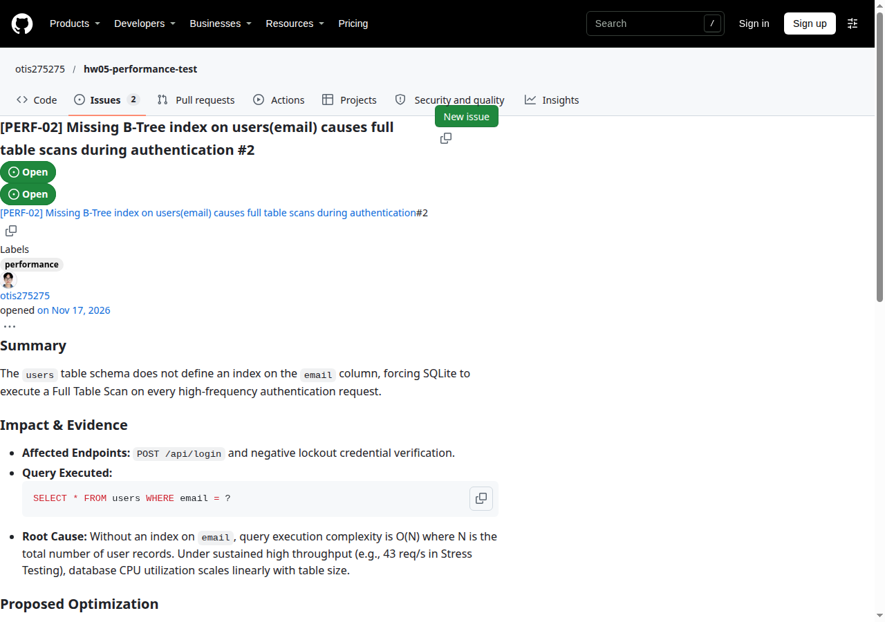
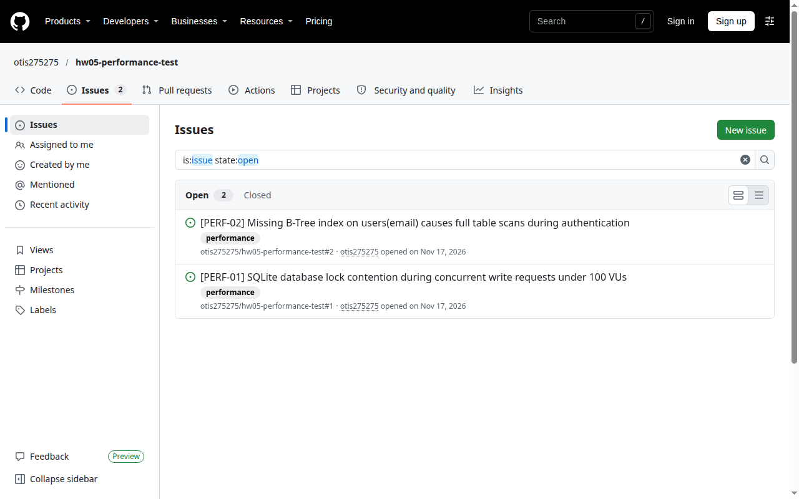

# HỒ SƠ BÁO CÁO LỖI & SỰ CỐ HIỆU NĂNG (BUG & PERFORMANCE REPORT)

- **Hệ thống kiểm thử (SUT):** eShop Backend (Node.js/Express + SQLite)
- **Người báo cáo:** Lê Trung Thành Đạt (MSSV: 23120228)
- **Môn học:** Kiểm thử phần mềm (CQ2023/31)

---

## 1. BUG-01 (Chức năng / Bảo mật): Bộ đếm Lockout tăng sai quy cách, khóa tài khoản chỉ sau 2 lần sai mật khẩu

* **Mức độ nghiêm trọng (Severity):** High (Ảnh hưởng nghiêm trọng đến trải nghiệm người dùng)
* **Vị trí lỗi trong mã nguồn:** [eshop-sut/backend/server.js#L54-L62](file:///home/sv/Downloads/seminar%20testing/Software-Testing-Seminar-Group10/eshop-sut/backend/server.js#L54-L62)

### Mô tả chi tiết:
Trong đặc tả yêu cầu nghiệp vụ [FR-02: Đăng nhập & Khóa tài khoản](file:///home/sv/Downloads/seminar%20testing/Software-Testing-Seminar-Group10/eshop-sut/README.md#L38-L44):
> *"Sau mỗi lần đăng nhập sai, hệ thống tăng bộ đếm lên **đúng 1 đơn vị**. Nếu đăng nhập sai từ **3 lần trở lên** liên tiếp, tài khoản bị tạm khóa."*

Tuy nhiên, trong mã nguồn `server.js`:
```javascript
} else {
  const newAttempts = user.login_attempts + 2; // BUG: Tăng 2 đơn vị mỗi lần sai!
  let lockedUntil = null;
  if (newAttempts >= 3) {
    lockedUntil = new Date(Date.now() + 180000).toISOString();
  }
  db.run(
    "UPDATE users SET login_attempts = ?, locked_until = ? WHERE id = ?",
    [newAttempts, lockedUntil, user.id],
  );
  res.status(401).json({ error: "Invalid email or password" });
}
```

### Hậu quả thực tế:
* **Lần đăng nhập sai thứ 1:** `login_attempts` chuyển từ $0 \rightarrow 2$ (chưa $\ge 3$, trả về 401).
* **Lần đăng nhập sai thứ 2:** `login_attempts` chuyển từ $2 \rightarrow 4$ ($\ge 3$, **LẬP TỨC KHÓA TÀI KHOẢN** và trả về 401).
* **Lần đăng nhập thứ 3:** Khi người dùng nhập lại (kể cả nhập đúng mật khẩu), tài khoản đã bị khóa và server trả về `403 Forbidden` (*"Tài khoản đã bị khóa. Vui lòng thử lại sau."*).
* Người dùng chỉ mới nhập sai **đúng 2 lần** đã bị khóa tài khoản 3 phút (thay vì 3 lần như đặc tả).

### Đề xuất sửa đổi (Fix):
Thay đổi `user.login_attempts + 2` thành `user.login_attempts + 1`:
```javascript
const newAttempts = user.login_attempts + 1;
```

---

## 2. PERF-01 (Hiệu năng): SQLite Table Lock Contention khi chịu tải ghi đồng thời ở Stress Test

* **GitHub Issue:** [#1 (PERF-01 on GitHub)](https://github.com/otis275275/hw05-performance-test/issues/1)
* **Mức độ nghiêm trọng:** Medium
* **Vị trí phát hiện:** Thao tác Transactional `PUT /api/users/me` dưới mức tải 100 VUs.
* **Ảnh minh chứng trên GitHub Issues:**
  

### Mô tả chi tiết:
* SQLite là cơ sở dữ liệu dựa trên file đơn cục bộ (`database.sqlite`). Theo mặc định, SQLite sử dụng chế độ **Rollback Journal**.
* Trong chế độ này, khi một VU thực hiện câu lệnh ghi `UPDATE users SET name = ... WHERE id = ?`, SQLite sẽ cấp một khóa độc quyền (Exclusive Lock) trên toàn bộ file database.
* Ở kịch bản Stress Test khi 100 VUs cùng chạy luồng E2E và cùng kích hoạt thao tác ghi, các kết nối phải xếp hàng đợi giải phóng khóa, đẩy độ trễ ghi của `profile_update_duration` từ mức cơ sở ~2ms lên đỉnh 18.24ms.

### Đề xuất tối ưu hóa (Fix):
Kích hoạt chế độ **Write-Ahead Logging (WAL)** trong file `backend/database.js` ngay sau khi mở kết nối:
```javascript
db.run("PRAGMA journal_mode = WAL;");
```
*Chế độ WAL cho phép 1 tiến trình ghi và nhiều tiến trình đọc diễn ra song song độc lập, giảm thiểu tối đa hiện tượng lock contention.*

---

## 3. PERF-02 (Hiệu năng): Thiếu chỉ mục (B-Tree Index) trên cột `email` bảng `users`

* **GitHub Issue:** [#2 (PERF-02 on GitHub)](https://github.com/otis275275/hw05-performance-test/issues/2)
* **Mức độ nghiêm trọng:** Low - Medium (Tăng dần theo kích thước database)
* **Vị trí phát hiện:** Bảng `users` trong `backend/database.js`.
* **Ảnh minh chứng trên GitHub Issues:**
  

### Mô tả chi tiết:
* Cả hai API tần suất cao là `POST /api/login` và kiểm tra tài khoản đều chạy câu lệnh:
  ```sql
  SELECT * FROM users WHERE email = ?
  ```
* Bảng `users` trong schema hiện tại không có chỉ mục cho cột `email`, buộc SQLite phải thực hiện **Full Table Scan ($O(N)$)** duyệt tuần tự từ đầu đến cuối bảng trên mỗi request đăng nhập.

### Đề xuất tối ưu hóa (Fix):
Thêm câu lệnh tạo chỉ mục:
```sql
CREATE INDEX IF NOT EXISTS idx_users_email ON users(email);
```

---

## 4. TỔNG HỢP DANH SÁCH ISSUES TRÊN GITHUB REPOSITORY

Toàn bộ các sự cố hiệu năng đã được lập thành GitHub Issues chính thức tại kho lưu trữ [hw05-performance-test/issues](https://github.com/otis275275/hw05-performance-test/issues):



