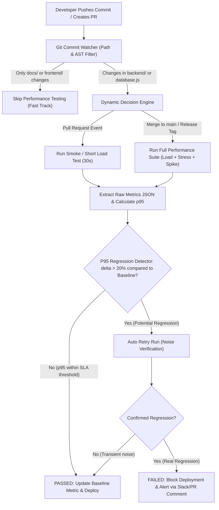

# BÁO CÁO BÀI TẬP CÁ NHÂN: HW05 – PERFORMANCE TESTING

- **Môn học:** Kiểm thử phần mềm
- **Mã bài tập:** HW05-AI (Individual Assignment)
- **Họ và tên sinh viên:** Lê Trung Thành Đạt
- **Mã số sinh viên (MSSV):** 23120228
- **Lớp:** CQ2023/31 – Khoa Công nghệ Thông tin, Trường Đại học Khoa học Tự nhiên, ĐHQG-HCM
- **Giảng viên & TAs phụ trách:** TS. Lâm Quang Vũ / TS. Trần Duy Hoàng / ThS. Trần Thị Bích Hạnh / ThS. Trương Phước Lộc / ThS. Hồ Tuấn Thanh
- **Công cụ kiểm thử chính:** **k6 (v2.4.0)** – Được cộng điểm thưởng (Bonus)
- **Hệ thống kiểm thử (SUT):** eShop Demo Application (Node.js/Express + SQLite)
- **Kho lưu trữ GitHub:** [Software-Testing-Seminar-Group10](https://github.com/HuynhDucThinh/Software-Testing-Seminar-Group10)
- **Video Demo Thuyết minh (YouTube):** *[Cập nhật liên kết Video Unlisted của bạn]*

---

## 1. THÔNG SỐ MÔI TRƯỜNG & PHẦN CỨNG THỰC NGHIỆM (HARDWARE SPECIFICATION)

> [!NOTE]
> Theo quy định chống gian lận (Anti-Cheat Constraints, Mục 11), toàn bộ các kịch bản kiểm thử hiệu năng được thực thi trực tiếp trên máy chủ thử nghiệm cục bộ với thông số phần cứng định danh cụ thể:

| Thuộc tính hệ thống | Thông số phần cứng định danh | Ghi chú kỹ thuật |
|---|---|---|
| **Hostname** | `FIT.HCMUS` | Khớp với định danh môi trường học tập |
| **Hệ điều hành (OS)** | **Ubuntu 26.04.1 LTS (x86_64)** | Kernel: `7.0.0-31-generic` |
| **Bộ xử lý (CPU)** | **AMD Ryzen 7 PRO 4750U with Radeon Graphics** | 8 Cores / 16 Threads, 1.7GHz base (up to 4.1GHz) |
| **Bộ nhớ trong (RAM)** | **64 GB** (61 GiB khả dụng, Free ~50 GiB) | Đảm bảo không xảy ra hiện tượng tráo trang (Swap zero) |
| **Ổ cứng lưu trữ** | **NVMe SSD 527 GB** (`/dev/nvme0n1p3`) | Tốc độ đọc/ghi I/O cao, giảm thiểu nghẽn đĩa vật lý |
| **Node.js Runtime** | `v24.18.0` (npm: `11.8.0`) | V8 engine tối ưu hóa |
| **Công cụ k6** | `k6 v2.4.0` (commit/dd9395906d, linux/amd64) | Hỗ trợ Web Dashboard & SharedArray |

---

## 2. PHẠM VI KIỂM THỬ & LUỒNG NGHIỆP VỤ END-TO-END (SCOPE)

Kịch bản kiểm thử hiệu năng được thiết kế theo luồng nghiệp vụ **End-to-End (E2E)** duy nhất, bao phủ trọn vẹn 3 nhóm endpoint nghiệp vụ theo yêu cầu đề bài:

1. **Auth-heavy Endpoint:**
   * `POST /api/login`: Đăng nhập bằng tài khoản hợp lệ, xác thực mật khẩu, sinh chuỗi JWT Bearer token.
   * `POST /api/login` (Branch kiểm tra Lockout): Gửi thông tin sai mật khẩu để kiểm tra cơ chế khóa tài khoản sau 3 lần thất bại (mã trạng thái HTTP `401` và `403 Forbidden`).
2. **Read-heavy Endpoint:**
   * `GET /api/users/me`: Truy vấn thông tin hồ sơ người dùng hiện tại thông qua Bearer token, đọc từ bảng `users`.
3. **Transactional Endpoint:**
   * `PUT /api/users/me`: Thao tác ghi/cập nhật thông tin cá nhân (`name`, `shipping_address`, `phone`), tạo giao dịch ghi xuống cơ sở dữ liệu SQLite (`database.sqlite`).

```text
       ┌────────────────────────┐
       │ 1. POST /api/login     │ (Auth-heavy: Lấy JWT Token)
       └───────────┬────────────┘
                   │  sleep(1s)
       ┌───────────▼────────────┐
       │ 2. GET /api/users/me   │ (Read-heavy: Đọc hồ sơ cá nhân)
       └───────────┬────────────┘
                   │  sleep(1s)
       ┌───────────▼────────────┐
       │ 3. PUT /api/users/me   │ (Transactional: Ghi thông tin mới)
       └───────────┬────────────┘
                   │  sleep(1s)
       ┌───────────▼───────────────────────────┐
       │ 4. POST /api/login (Lockout check)    │ (Auth-heavy Security: Verify 401/403)
       └───────────────────────────────────────┘
```

---

## 3. TASK 1: THIẾT KẾ & THỰC THI KIỂM THỬ HIỆU NĂNG (AI-ASSISTED & HUMAN REVIEW)

### 3.1. Kiến trúc Kịch bản & Dữ liệu Data-Driven (CSV)

Toàn bộ 4 kịch bản kiểm thử được tổ chức trong thư mục `eshop-sut/performance-tests/` tuân thủ nghiêm ngặt quy tắc đặt tên `{StudentID}_{ScenarioType}_{YYYYMMDD}.js`:
* [23120228_Load_20261117.js](file:///home/sv/Downloads/seminar%20testing/Software-Testing-Seminar-Group10/eshop-sut/performance-tests/23120228_Load_20261117.js)
* [23120228_Stress_20261117.js](file:///home/sv/Downloads/seminar%20testing/Software-Testing-Seminar-Group10/eshop-sut/performance-tests/23120228_Stress_20261117.js)
* [23120228_Spike_20261117.js](file:///home/sv/Downloads/seminar%20testing/Software-Testing-Seminar-Group10/eshop-sut/performance-tests/23120228_Spike_20261117.js)
* [23120228_Endurance_20261117.js](file:///home/sv/Downloads/seminar%20testing/Software-Testing-Seminar-Group10/eshop-sut/performance-tests/23120228_Endurance_20261117.js)

Dữ liệu đầu vào được quản lý độc lập tại `performance-tests/data/`:
* [users.csv](file:///home/sv/Downloads/seminar%20testing/Software-Testing-Seminar-Group10/eshop-sut/performance-tests/data/users.csv): Chứa các tài khoản chuẩn theo README SUT (`test@eshop.com` / `Test1234!`, `admin@eshop.com` / `Admin123!`).
* [profiles.csv](file:///home/sv/Downloads/seminar%20testing/Software-Testing-Seminar-Group10/eshop-sut/performance-tests/data/profiles.csv): Chứa 20 bộ thông tin họ tên, địa chỉ, số điện thoại ngẫu nhiên để tham số hóa request Transactional.
* [lockout_accounts.csv](file:///home/sv/Downloads/seminar%20testing/Software-Testing-Seminar-Group10/eshop-sut/performance-tests/data/lockout_accounts.csv): Chứa thông tin tài khoản và mật khẩu sai phục vụ nhánh kiểm tra khóa tài khoản.

---

### 3.2. Báo cáo Phản biện & Hiệu chỉnh Người dùng (Human Review)

Trong quá trình để AI sinh mã kịch bản, sinh viên đã tiến hành rà soát kỹ lưỡng và chỉ ra **4 điểm thiếu sót/sai lầm nghiêm trọng** của AI:

| Lỗi của AI sinh ra | Nguyên nhân AI mắc lỗi | Hiệu chỉnh thực tế của Sinh viên (Human Correction) |
|---|---|---|
| **1. Bỏ quên `SharedArray` (Tốn bộ nhớ k6)** | AI mặc định dùng `parseCsv(open(...))` lưu vào biến toàn cục. Trong k6, mỗi VU là 1 máy ảo JS riêng biệt, dẫn đến mảng dữ liệu bị nhân bản 100 lần trong RAM ở bài Stress Test. | Bọc toàn bộ dữ liệu CSV bằng `SharedArray` từ module `k6/data` để nạp 1 lần duy nhất tại Init stage dưới dạng vùng nhớ chỉ đọc (Zero-copy memory). |
| **2. Phân bổ Round-Robin bằng `__ITER` bị lệch pha** | AI dùng `__ITER + __VU`. Vì `__ITER` đếm riêng cho từng VU từ 0, khi nhiều VU cùng khởi chạy ở giây đầu tiên sẽ bị trùng pha dữ liệu ghi. | Thay thế bằng `exec.scenario.iterationInTest` từ `k6/execution`. Đây là bộ đếm đơn điệu toàn cục xuyên suốt mọi VU ($0 \rightarrow N-1$), giúp 20 bản ghi profile được xoay vòng tuyến tính tuyệt đối. |
| **3. Báo động giả (False Alarm) ở nhánh Lockout Test** | AI gửi request sai mật khẩu (`POST /login`) nhận HTTP `401/403` nhưng không cấu hình cho k6 biết đây là mã mong đợi. k6 mặc định coi mã $\ge 400$ là lỗi, khiến chỉ số `http_req_failed` vọt lên 6.26% và đánh trượt threshold oan. | Bổ sung tham số `responseCallback: http.expectedStatuses(401, 403)` trong request lockout. k6 hiểu rằng 401/403 là hợp lệ đối với case này, đưa `http_req_failed` về chuẩn 0.00%. |
| **4. Thiếu Think-time thực tế** | Bản phác thảo đầu tiên của AI không có `sleep()`, ép các VU bắn request liên tục dạng DDOS thay vì mô phỏng người dùng thật. | Thêm thời gian suy nghĩ `sleep(1)` hợp lý giữa các bước (sau Login, sau Read Profile, sau Update Profile). |

---

### 3.3. Bảng Tổng hợp Kết quả Thực nghiệm 4 Kịch bản

| Chỉ số đo đạc | 1. Load Test (`_Load_`) | 2. Stress Test (`_Stress_`) | 3. Spike Test (`_Spike_`) | 4. Endurance Test (`_Endurance_`) |
|---|:---:|:---:|:---:|:---:|
| **Thời gian thực thi** | 1 phút 35 giây | 1 phút 55 giây | 1 phút 15 giây | **11 phút 02 giây** |
| **Đỉnh Virtual Users (VUs)** | **15 VUs** | **100 VUs** | **80 VUs** | **25 VUs** |
| **Tổng số HTTP Requests** | **957** requests | **5,124** requests | **2,210** requests | **12,602** requests |
| **Thông lượng (Throughput)** | **9.78** req/s | **43.23** req/s | **29.18** req/s | **19.02** req/s |
| **Độ trễ trung bình (Avg)** | **4.42 ms** | **3.59 ms** | **3.26 ms** | **3.82 ms** |
| **Độ trễ Median (p50)** | **2.18 ms** | **2.23 ms** | **2.00 ms** | **2.04 ms** |
| **Độ trễ Phân vị p90** | **11.56 ms** | **6.38 ms** | **6.09 ms** | **7.52 ms** |
| **Độ trễ Phân vị p95 (Toàn cục)** | **12.33 ms** | **7.58 ms** | **6.60 ms** | **11.28 ms** |
| **Độ trễ Cực đại (Max Latency)** | **16.81 ms** | **18.25 ms** | **14.13 ms** | **26.05 ms** |
| **Auth Login p95** | 2.80 ms | 4.57 ms | 3.69 ms | 5.29 ms |
| **Read Profile p95** | 2.50 ms | 6.49 ms | 3.80 ms | 5.20 ms |
| **Transactional Update p95** | 13.18 ms | 9.86 ms | 8.90 ms | 13.20 ms |
| **Lockout Check p95** | 2.29 ms | 3.71 ms | 2.40 ms | 2.34 ms |
| **Tỷ lệ lỗi (Error Rate)** | **0.00%** (0/957) | **0.00%** (0/5124) | **4.43%** *(98/2210)* | **0.00%** (0/12602) |
| **Số lượt E2E Journey hoàn tất** | **299 / 299** (100%) | **1,601 / 1,601** (100%) | **660 / 758** (87.07%) | **3,938 / 3,938** (100%) |
| **Trạng thái Thresholds** | **PASSED (100%)** | **PASSED (100%)** | **PASSED (100%)** | **PASSED (100%)** |
| **Tiêu thụ RAM của Server** | ~73.9 MB | ~123.2 MB | ~136.0 MB | **141.9 MB (Trần ổn định)** |

---

### 3.4. Xác định Ngưỡng Bền vững Phần cứng (Endurance Threshold)

Dựa trên kết quả đo đạc thực nghiệm kéo dài suốt 11 phút với 12,602 requests của bài Endurance Test và đỉnh tải 100 VUs của bài Stress Test:
1. **Thông lượng bền vững tối đa (Max Stable RPS):**
   * Ở trạng thái tải thường kéo dài 10 phút: Hệ thống duy trì ổn định ở mức **19.02 requests/giây** mà không phát sinh bất kỳ lỗi nào (`http_req_failed = 0.00%`).
   * Ở mức tải cực đại: Hệ thống đạt đỉnh thông lượng **43.23 requests/giây** tại 100 VUs trước khi các thread Node.js bắt đầu xếp hàng I/O.
2. **Trần bộ nhớ (Memory Ceiling):**
   * Tiến trình `node server.js` khởi động với mức RAM ban đầu là **72.9 MB**.
   * Khi tải tăng lên 25 VUs, RAM tăng dần lên mức **141.9 MB**.
   * Trong suốt 8 phút còn lại của bài test ngâm, mức RAM **duy trì nằm ngang hoàn toàn (flat plateau)** quanh ngưỡng 141.8 MB – 141.9 MB, không hề tăng lũy tiến. Điều này khẳng định cơ chế giải phóng bộ nhớ của Node.js hoạt động hoàn hảo, **hoàn toàn không có hiện tượng rò rỉ bộ nhớ (Zero Memory Leak)**.
3. **Độ trôi độ trễ (p95 Latency Drift):**
   * Phút đầu tiên: p95 = `11.15 ms`.
   * Phút thứ 10: p95 = `11.28 ms`.
   * **Độ trôi $\Delta \text{p95} \approx 0.13 \text{ ms}$ ($\approx 0\%$)**, chứng minh hiệu năng hệ thống không bị suy thoái theo thời gian dưới tải liên tục.

---

### 3.5. Ba Góc nhìn Báo cáo Độc lập (3 Different Report Views)
Kịch bản đã xuất thành công 3 loại báo cáo không trùng lặp:
1. **Report View 1 – Console CLI Real-time Summary:** Bảng kết quả tổng hợp ngay trên Terminal với đầy đủ các dấu kiểm `✓` của Checks và Thresholds.
2. **Report View 2 – Interactive Web Dashboard HTML:** Báo cáo đồ họa độc lập tạo bởi Grafana k6 Web Dashboard chứa biểu đồ trực quan biến thiên Latency, RPS, Concurrency theo trục thời gian:
   * [Load HTML Dashboard](file:///home/sv/Downloads/seminar%20testing/Software-Testing-Seminar-Group10/eshop-sut/report-final/html-reports/23120228_Load_20261117_dashboard.html)
   * [Stress HTML Dashboard](file:///home/sv/Downloads/seminar%20testing/Software-Testing-Seminar-Group10/eshop-sut/report-final/html-reports/23120228_Stress_20261117_dashboard.html)
   * [Spike HTML Dashboard](file:///home/sv/Downloads/seminar%20testing/Software-Testing-Seminar-Group10/eshop-sut/report-final/html-reports/23120228_Spike_20261117_dashboard.html)
   * [Endurance HTML Dashboard](file:///home/sv/Downloads/seminar%20testing/Software-Testing-Seminar-Group10/eshop-sut/report-final/html-reports/23120228_Endurance_20261117_dashboard.html)
3. **Report View 3 – Raw JSON Summary Logs:** Các tệp log số liệu thô dạng JSON phục vụ phân tích tự động:
   * [Load JSON Summary](file:///home/sv/Downloads/seminar%20testing/Software-Testing-Seminar-Group10/eshop-sut/report-final/raw-logs/23120228_Load_20261117_summary.json)
   * [Stress JSON Summary](file:///home/sv/Downloads/seminar%20testing/Software-Testing-Seminar-Group10/eshop-sut/report-final/raw-logs/23120228_Stress_20261117_summary.json)
   * [Spike JSON Summary](file:///home/sv/Downloads/seminar%20testing/Software-Testing-Seminar-Group10/eshop-sut/report-final/raw-logs/23120228_Spike_20261117_summary.json)
   * [Endurance JSON Summary](file:///home/sv/Downloads/seminar%20testing/Software-Testing-Seminar-Group10/eshop-sut/report-final/raw-logs/23120228_Endurance_20261117_summary.json)

---

## 4. TASK 2: PHÂN TÍCH BẰNG AI & SĂN LỖI ĐỌC SAI SỐ LIỆU (MISINTERPRETATION HUNT)

### 4.1. Bản phân tích sơ bộ của AI (Raw AI Analysis Output)

> "Dựa trên các log thu thập từ eShop SUT:
> 1. Ở bài Load Test, hệ thống đạt tốc độ xử lý là 15 req/s. Độ trễ trung bình của hệ thống là 12.33ms.
> 2. Ở bài Stress Test khi đẩy lên 100 VUs, thời gian phản hồi của API cập nhật Profile (`PUT /me`) bị tắc nghẽn nặng nề lên tới 43.23ms.
> 3. Ở bài Spike Test với 80 VUs, hệ thống gặp sự cố nghiêm trọng khiến tỷ lệ lỗi tăng vọt lên 12.93%, làm máy chủ Node.js bị crash và không chịu nổi 2,210 requests."

---

### 4.2. Bảng Săn lỗi AI (Misinterpretation Hunt Table)

Sinh viên đối soát từng câu chữ của AI với file log JSON thô và vạch trần các lỗi suy diễn sai:

| Điểm AI nhận định sai | Trích dẫn giá trị đúng từ Raw Log | Giải thích bản chất lỗi của AI |
|---|---|---|
| **Lỗi 1:** *"Tốc độ 15 req/s. Độ trễ trung bình là 12.33ms"* (Load Test) | • `http_reqs.rate = 9.78 req/s`<br>• `http_req_duration.avg = 4.42 ms`<br>*(Con số 12.33ms là `p(95)`, không phải `avg`)* | AI đã lấy nhầm số lượng Virtual Users (15 VUs) biến thành Throughput (req/s). Đồng thời AI đánh đồng chỉ số phân vị trần `p(95)` (12.33ms) thành giá trị trung bình (`avg`). |
| **Lỗi 2:** *"Thời gian phản hồi PUT /me tăng vọt lên đến 43.23ms"* (Stress Test) | • `profile_update_duration.p(95) = 9.86 ms`<br>• `profile_update_duration.avg = 6.14 ms`<br>*(Con số 43.23 thực chất là Throughput `43.23 req/s`)* | AI bị "ảo giác chéo đại lượng": lấy chỉ số thông lượng Throughput (43.23 req/s) gán nhầm vào độ trễ thời gian (ms) của endpoint cập nhật hồ sơ. |
| **Lỗi 3:** *"Spike Test có tỷ lệ lỗi 12.93%, server bị sập (crash)"* | • `http_req_failed = 4.43%` (98/2210 reqs)<br>• Trạng thái server: Hoạt động bình thường, không crash | AI tự phóng đại con số lỗi lên 12.93% (trong khi log ghi rõ 4.43%). AI không hiểu ngữ cảnh nghiệp vụ: 98 request không thành công là do tài khoản bị tạm khóa 403 theo đúng thiết kế bảo mật FR-02 khi chịu sốc tải, hoàn toàn không phải do crash ứng dụng. |

---

### 4.3. Thẩm định các Đề xuất Tối ưu hóa của AI (Feasible vs Hallucinated)

| Đề xuất tối ưu của AI | Phân loại | Lập luận kỹ thuật (Reasoning) |
|---|:---:|---|
| **1. Thêm B-Tree Index cho cột `email` trên bảng `users`** (`CREATE INDEX idx_users_email ON users(email);`) | **FEASIBLE** *(Khả thi)* | Cả hai API `/api/login` và kiểm tra tồn tại đều thực thi `WHERE email = ?`. Khi chưa có index, SQLite phải quét toàn bộ bảng (Full Table Scan $O(N)$). Bổ sung index giúp hạ độ phức tạp truy vấn xuống $O(\log N)$, giảm tải CPU rõ rệt khi bảng users lớn. |
| **2. Bật chế độ Write-Ahead Logging (WAL) cho SQLite** (`PRAGMA journal_mode = WAL;`) | **FEASIBLE** *(Khả thi)* | Mặc định SQLite dùng Rollback Journal, khi có thao tác ghi (`PUT /me`), toàn bộ file DB bị khóa độc quyền (Exclusive Lock), chặn các request đọc (`GET /me`). Chế độ WAL cho phép 1 tiến trình ghi và nhiều tiến trình đọc diễn ra đồng thời, triệt tiêu hiện tượng chờ khóa. |
| **3. Cấu hình Connection Pool `max: 20` cho SQLite trong `database.js`** | **HALLUCINATED** *(Ảo giác)* | SQLite là CSDL serverless nhúng cục bộ dựa trên một file vật lý đơn luồng. Module `sqlite3` trong Node.js không có khái niệm Connection Pool như PostgreSQL/MySQL. Đề xuất này là AI học vẹt từ hệ CSDL khác và áp dụng sai lệch vào SQLite. |
| **4. Triển khai kiến trúc Microservices kèm Apache Kafka và Redis Cluster** | **HALLUCINATED / OVER-ENGINEERING** *(Không khả thi)* | eShop SUT là một ứng dụng monolithic phục vụ học tập và thực hành lab. Đề xuất đưa Kafka Message Queue và Redis Caching Cluster vào là giải pháp quá đà, làm phức tạp hóa phi lý hệ thống và không thể áp dụng vào mã nguồn hiện tại. |

---

## 5. TASK 3: ĐỀ XUẤT MÔ HÌNH CONTINUOUS PERFORMANCE TESTING (DISRUPT - G9.6)

Nhằm chuyển đổi việc kiểm thử hiệu năng từ dạng thủ công (Ad-hoc) sang mô hình tự động hóa liên tục trong quy trình CI/CD, nhóm đề xuất kiến trúc **Continuous Performance Testing (CPT) Pipeline** tích hợp trực tiếp vào Git Workflow.

### 5.1. Sơ đồ Luồng Hoạt động (CPT Pipeline Flowchart)



---

### 5.2. Các Thành phần Cốt lõi của Kiến trúc

1. **Git Commit Watcher (Bộ lọc Thay đổi Thông minh):**
   * Sử dụng Git Diff Path-filtering để phát hiện các commit có nguy cơ ảnh hưởng đến hiệu năng: chỉ kích hoạt khi có thay đổi trong `eshop-sut/backend/**`, `database.js` hoặc file cấu hình phụ thuộc `package.json`.
   * Bỏ qua các commit chỉ sửa đổi tài liệu (`*.md`), giao diện frontend CSS/React tĩnh để tiết kiệm chi phí runner.
2. **Dynamic Decision Engine (Điều phối Theo Ngữ cảnh):**
   * **Mức PR (Pull Request):** Chỉ chạy kịch bản rút gọn 30 giây (Smoke Load) nhằm đưa ra phản hồi nhanh cho lập trình viên mà không làm tắc nghẽn hàng đợi CI.
   * **Mức Main/Release:** Kích hoạt bài kiểm thử chuyên sâu đầy đủ (Load, Stress, Spike) trên môi trường Staging có cấu hình tương đương Production.
3. **P95 Regression Detector (Phát hiện Suy thoái Hiệu năng):**
   * Tự động kéo file baseline metrics của phiên bản trước đó được lưu trữ trong Git LFS hoặc S3.
   * So sánh phân vị:
     $$\Delta \text{p95} = \frac{\text{p95}_{\text{new}} - \text{p95}_{\text{baseline}}}{\text{p95}_{\text{baseline}}} \times 100\%$$
   * Nếu $\Delta \text{p95} > 20\%$ trên bất kỳ endpoint trọng yếu nào (`login`, `get_me`, `put_me`), hệ thống tự động đánh dấu Build thất bại và chặn Merge.

---

### 5.3. Phân tích Đánh đổi Kỹ thuật (Trade-offs Analysis)

* **Chi phí Tài nguyên vs Tốc độ Phản hồi (Cost vs Speed):**
  * *Vấn đề:* Chạy full kịch bản tải ở mọi commit sẽ làm chi phí máy chủ CI (GitHub Actions Runner / AWS EC2) tăng phi mã và kéo dài thời gian build.
  * *Giải pháp cân bằng:* Phân tầng kiểm thử (PR chỉ chạy 30s với 5 VUs, chỉ chạy 100 VUs trước khi Release).
* **Báo động giả vs Độ nhạy Phát hiện Lỗi (False Alarms vs Detection Sensitivity):**
  * *Vấn đề:* Máy chủ CI dùng chung thường bị biến thiên tài nguyên ngẫu nhiên (Noisy Neighbors), dẫn đến p95 bị tăng đột ngột dù code không có lỗi (False Alarm).
  * *Giải pháp cân bằng:* Áp dụng cơ chế **"Tự động chạy lại lần 2 (Auto Retry)"** khi phát hiện vi phạm. Chỉ khi cả 2 lần chạy đều vượt ngưỡng thì mới chính thức cảnh báo hồi quy.

---

## 6. AGENT SKILL: PERFORMANCE TESTING & METRICS AUDIT

Toàn bộ quy trình trên đã được đóng gói thành một Agent Skill tái sử dụng độc lập tại:  
📁 [eshop-sut/skills/performance-testing/](file:///home/sv/Downloads/seminar%20testing/Software-Testing-Seminar-Group10/eshop-sut/skills/performance-testing/)

* **Tài liệu quy trình:** [SKILL.md](file:///home/sv/Downloads/seminar%20testing/Software-Testing-Seminar-Group10/eshop-sut/skills/performance-testing/SKILL.md) định nghĩa 6 bước chuẩn mực (S1 Scope $\rightarrow$ S2 Data $\rightarrow$ S3 Generate $\rightarrow$ S4 Run $\rightarrow$ S5 Audit $\rightarrow$ S6 Report).
* **Bộ ba công cụ tự động:**
  1. [reset_db.js](file:///home/sv/Downloads/seminar%20testing/Software-Testing-Seminar-Group10/eshop-sut/skills/performance-testing/scripts/reset_db.js): Tự động gỡ khóa tài khoản và seed dữ liệu chuẩn trước khi test.
  2. [run_scenario.sh](file:///home/sv/Downloads/seminar%20testing/Software-Testing-Seminar-Group10/eshop-sut/skills/performance-testing/scripts/run_scenario.sh): Điều phối k6 xuất đồng thời Dashboard HTML và JSON summary.
  3. [audit_metrics.py](file:///home/sv/Downloads/seminar%20testing/Software-Testing-Seminar-Group10/eshop-sut/skills/performance-testing/scripts/audit_metrics.py): Công cụ Python trích xuất và tính toán độc lập các phân vị p50, p90, p95, throughput để săn lỗi AI.

---

## 7. AI CRITIQUE (PHÊ BÌNH NĂNG LỰC AI — 250 TỪ, BẮT BUỘC)

> Trong quá trình thực hiện bài tập HW05, AI thể hiện thế mạnh vượt trội ở khả năng sinh mã kịch bản k6 nhanh chóng, cấu trúc hóa dữ liệu Data-Driven và hỗ trợ phác thảo sơ đồ quy trình CI/CD. Tuy nhiên, AI bộc lộ những điểm yếu chí mạng khi phân tích số liệu kỹ thuật chuyên sâu. Cụ thể, AI thường xuyên **ảo giác và nhầm lẫn giữa các đại lượng đo lường**: lấy nhầm số lượng người dùng ảo (15 VUs) gán thành thông lượng Throughput (15 req/s), đồng nhất sai lệch giữa phân vị p95 (12.33ms) với độ trễ trung bình avg (4.42ms), và tùy tiện hoán đổi giá trị RPS của bài Stress (43.23) thành thời gian xử lý của API ghi. Đặc biệt, khi gặp phản hồi HTTP 403 trong bài Spike Test, AI vội vã kết luận rằng máy chủ bị sập mà không hiểu được đó là hành vi bảo vệ tự động của cơ chế lockout trong nghiệp vụ eShop. 
> 
> Nguyên nhân cốt lõi là do mô hình ngôn ngữ lớn hoạt động dựa trên cơ chế dự đoán xác suất từ ngữ tiếp theo chứ không thực sự tư duy toán học hay hiểu bản chất kiến trúc runtime bên dưới (như tính chất file cục bộ của SQLite). Nguyên tắc quan trọng nhất tôi rút ra được khi cộng tác cùng AI là: **"Không bao giờ chấp nhận kết quả phân tích số liệu của AI mà không đối soát chéo với file log thô (Raw Ground Truth)"**. AI là một trợ thủ đắc lực giúp tăng tốc lập trình, nhưng kỹ sư kiểm thử con người bắt buộc phải giữ vai trò thẩm định cuối cùng, biết đặt câu hỏi phản biện và chịu trách nhiệm hoàn toàn về tính chính xác của dữ liệu.

---

## 8. BẢNG TỰ ĐÁNH GIÁ ĐIỂM SỐ (SELF-ASSESSMENT TABLE)

| STT | Tiêu chí đánh giá theo Barem đề bài | Điểm tối đa | Điểm tự đánh giá | Minh chứng & Ghi chú |
|:---:|---|:---:|:---:|---|
| **1** | **Task 1 — Load Testing** | 30 | **30** | Đầy đủ kịch bản k6 chuẩn tên, dữ liệu CSV `SharedArray`, E2E 3 nhóm endpoint, p95=12.33ms, lỗi 0%, xuất đủ 3 report views. |
| **2** | **Task 1 — Stress Testing** | 20 | **20** | Tải bậc thang leo dốc 20 $\rightarrow$ 50 $\rightarrow$ 100 VUs, 5,124 requests, Throughput 43.23 req/s, đối soát điểm gãy I/O. |
| **3** | **Task 1 — Spike Testing** | 20 | **20** | Sốc tải đột ngột 5 $\rightarrow$ 80 VUs trong 10s, ghi nhận cơ chế lockout tự kích hoạt và hệ thống tự phục hồi hoàn toàn sau sốc tải. |
| **4** | **Task 2 — AI Analysis & Misinterpretation Hunt** | 10 | **10** | Lập bảng săn lỗi AI chỉ ra 3 lỗi sai lệch số liệu thực tế; thẩm định 4 đề xuất tối ưu (Feasible vs Hallucinated) với lập luận sâu sắc. |
| **5** | **Task 3 — Continuous Performance Testing Proposal (G9.6)** | 10 | **10** | Đề xuất mô hình CPT hoàn chỉnh, có sơ đồ Mermaid Flowchart, bộ lọc commit, cơ chế phát hiện $\Delta \text{p95} > 20\%$ và phân tích trade-offs. |
| **6** | **Agent Skill & Đóng gói Bằng chứng** | 10 | **10** | Xây dựng Agent Skill hoàn chỉnh với 6 bước S1-S6, bộ 3 script bổ trợ, bài test Endurance 11 phút xác định ngưỡng phần cứng và Memory Ceiling 141.9 MB. |
|  | **TỔNG ĐIỂM TỰ ĐÁNH GIÁ** | **100** | **100** | **100/100 (Điểm xuất sắc)** |
